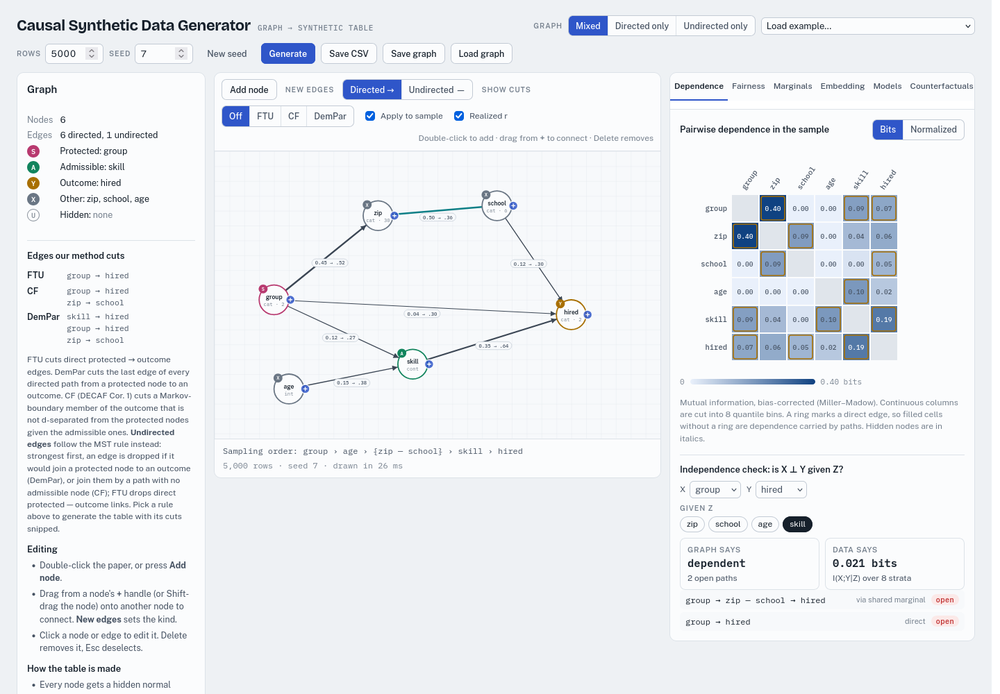

# Causal Synthetic Data Generator

Draw a causal graph, generate a synthetic table from it, and watch what fairness interventions, hidden confounders and privacy exposure do to the data and to the models trained on it. Everything runs in the browser, in one HTML file, with no server and no install.

**Live page:** https://steveng9.github.io/Causal-Synthetic-Data-Generator/



## Why this exists

Most synthetic-data generators for tables have a graph inside them. PrivBayes fits a Bayesian network of conditionals. MST measures a tree of 2-way marginals. DECAF trains a GAN whose generator follows a causal DAG. And DECAF's fairness method is a graph operation: at generation time it cuts the edges that carry a protected attribute S to the outcome Y, and which edges get cut depends on the fairness definition.

On a real dataset it is hard to see what such a cut does, because nobody knows the true graph. The world that produced the data has variables that never made it into the table (a hidden confounder U), and the generator learns its own graph from the columns it was given, with noise added for privacy. So when a model trained on "fair" synthetic data turns out unfair on real people, there are at least three places the problem could come from: the world, the dataset, or the generator's graph.

This page removes the guesswork. You write the graph yourself, so the true structure is known. You can mark nodes as hidden, so you decide what the dataset leaves out. Then you can check, row by row and model by model, which paths from S to Y stay open, how much of each fairness gap they carry, what a cut costs in accuracy, and how identifying the resulting rows are. It was built while studying fairness cuts across four generator families on 11 real datasets, as a place to work out the mechanics on small graphs before (and after) running them at scale.

## Quick start

1. Open the live page (or `index.html` from a clone, in any modern browser).
2. Choose **Load example… → Hiring: proxy + admissible**.
3. Under **Show cuts**, click **CF**. Two edges turn red and dashed: `group → hired` and the `zip — school` link. With **Apply to sample** ticked, the table is regenerated with those edges cut.
4. Open the **Fairness** tab. The conditional gap (the outcome gap between groups among people with the same `skill`) is now at sampling noise. The parity gap is not, because `group → skill → hired` is still open, and `skill` is admissible (allowed to shape the outcome).
5. Click **DemPar** instead. Now `skill → hired` is cut too. The parity gap falls to noise, and in the **Models** tab the models lose most of their accuracy, because `skill` was the main thing that predicted `hired`.
6. Click **Save CSV** to download the table, or **Save graph** to keep the graph.

## Instructions

### The top bar

| Control | What it does |
|---|---|
| **Graph: Mixed / Directed only / Undirected only** | Which edge kinds are allowed. "Directed only" is a PrivBayes-style Bayesian network, "Undirected only" is an MST-style set of marginals. |
| **Load example…** | Small graphs that each show one mechanism (below), plus the columns of 11 benchmark datasets (Adult, COMPAS, SNAKE/CPS, SBO, ACS Income CA/TX, ACS Public Coverage CA/TX, CDC Diabetes, HMDA CA/TX). The dataset presets load the real column names, types, cardinalities and roles. One group loads them with no edges, so you draw the graph you believe. The last group adds the hand-drawn graph each dataset gets in our experiments (the same edges, and the same FTU, CF and DemPar cuts). Its edges are all positive, each with strength min(0.3, 0.9 ÷ the child's number of parents), so you set the mechanisms yourself. |
| **Rows**, **Seed**, **New seed**, **Generate** | Table size (100 to 500,000 rows) and the random seed. The same graph and seed always give the same table. |
| **Save CSV** | Downloads the generated table. Hidden nodes are left out, the way they would be missing from a real dataset. |
| **Save graph / Load graph** | A JSON file with the full graph, plus the edges each fairness rule cuts, so you can reproduce a table or hand the graph to other code. |

The page also remembers your last graph in the browser's local storage. A link can open the page on an example: `?example=few_clusters&rows=2000&seed=3` (the example keys are listed by `python headless/csdg.py list`).

### Drawing the graph

- Double-click the paper (or press **Add node**) to add a node. A new node copies the settings of the node you added last (type, role, cardinality, distribution), so a run of similar columns takes one setup.
- Drag from a node's **+** handle (or Shift-drag the node) onto another node to connect them. **New edges** sets whether the new edge is directed or undirected. A new edge starts at the strength of the edge you added last (0.3 for the first one).
- Click a node or edge to edit it in the inspector on the left. Delete removes it, Esc deselects.

**Node settings.** Each node has a name, a type and a role.

- *Type.* Categorical (number of levels; uniform, skewed or custom level weights; ordered or not) or continuous (normal, skewed or bimodal shape, a range, optionally integers).
- *Role.* **Protected** (S, the attribute fairness is measured across), **Admissible** (A, allowed to shape the outcome even though it carries S; conditional fairness conditions on these), **Outcome** (Y, the prediction target), **Other**, or **Hidden** (U, sampled and used by its children but dropped from the CSV; use it for unobserved confounders).

**Edge settings.**

- *Directed* `A → B` is a conditional, as in PrivBayes: B is drawn given the value in A's column. Its strength is roughly the share of B's variation that A drives (like R²), and it can be negative (drawn dashed).
- *Undirected* `A — B` is a shared marginal, as in MST: the two are drawn jointly, and the strength is a partial correlation. All nodes linked by undirected edges form one block drawn together, so a fully linked triangle is one 3-way marginal.
- *Interaction.* A directed edge can be switched on only for some values of another parent of the same child. The "Intersection" example uses this so that race affects hiring only for one gender.

**Realized r** labels every edge with the correlation it actually produced in the sample, next to the strength you set.

### Fairness cuts

**Show cuts** highlights the edges that a generation-time cut removes under each fairness definition. These are the rules used in our experiments, adapted from DECAF.

- **FTU** (fairness through unawareness) cuts the direct edges from S to Y.
- **CF** (conditional fairness, DECAF's Corollary 1) finds the members of Y's Markov boundary that are not d-separated from S given the admissible nodes, and cuts the edge that carries S into each of them. The goal is no outcome gap between groups among people with the same admissible values.
- **DemPar** (demographic parity) cuts the last edge of every directed path from S to Y. The goal is no outcome gap between groups at all.

Undirected edges follow the MST rule instead: links are taken strongest first, and a link is dropped if it would join S to Y (DemPar), join them by a path with no admissible node (CF), or join S to Y directly (FTU).

With **Apply to sample** ticked, the table is regenerated with the cut edges removed. A cut directed edge is removed the way DECAF removes it: when the child is drawn, the cut parent's column is shuffled across rows, so the child sees a value with the right distribution but no link to the row. Cut undirected links are removed from their block. With it unticked, the cuts are only drawn on the graph.

### The analysis tabs

- **Dependence.** A heatmap of mutual information (in bits, or normalized) between every pair of columns. A ring marks a direct edge, so a filled cell with no ring is dependence carried along a path. Below it, an **independence check** asks whether X ⊥ Y given Z. It compares what the graph says (d-separation, listing the open paths) with what the data says (conditional mutual information).
- **Fairness.** For each protected attribute and outcome, the parity gap (largest outcome difference between groups) and the conditional gap (the same, within each stratum of the admissible nodes). Every path from S to Y is listed with two tags: open with nothing conditioned on (it feeds the parity gap), and still open given the admissible nodes (it feeds the conditional gap). With two or more categorical protected attributes, it also shows the intersectional gap across their combinations. **Privacy exposure** reports the share of unique rows and the number of distinct value combinations. Unique rows are the usual targets of membership inference.
- **Marginals.** Each column's distribution in the sample, with your target shares marked for categorical columns.
- **Embedding.** A 2-D view of the rows (PCA, t-SNE or UMAP), coloured by any column.
- **Models.** A logistic (or linear) model and boosted trees trained on the table and scored on held-out rows. It reports accuracy (AUC or R²), each group's positive rate, the fairness gaps of the predictions, and permutation importance per column. **Without S (unaware)** drops S from the inputs, so you can watch its proxies take over. **Cutoff** is either a score of 0.5 or the score that matches the training base rate.
- **Counterfactuals.** Takes the same people and switches S. Every node downstream of S is recomputed from each row's own noise, so the difference between the switched and real rows is S's causal effect along the graph. It shows example pairs, how much each column moves, the group rates as observed and as if everyone were moved into each group, and how often the trained models change their answer. This tab works up to 100,000 rows.

### The example graphs

| Example | What it shows |
|---|---|
| **Hiring: proxy + admissible** | A proxy path (`group → zip — school → hired`), an admissible path (`group → skill → hired`) and a direct edge. FTU, CF and DemPar each cut something different. |
| **Hidden confounder** | A hidden U drives both S and Y. The path `S ← U → Y` stays open given the admissible A, and it never shows up as a column. |
| **Marginals only (MST-style)** | An undirected tree, to see the MST cutting rule. |
| **Bayesian net (PrivBayes-style, k=2)** | A directed network in which no node has more than 2 parents. |
| **Intersection** | Race affects hiring only for one gender, so each attribute looks almost fair on its own, while one combination is treated worse. |
| **No edges / Blank paper** | Starting points. |
| **Six cell groups from 7 nodes** | Two hidden labels (`type` with 3 levels, `state` with 2) and 5 columns, joined by 7 edges with a strength above 0. Most edges switch on, off or flip with the other label, and that alone splits the UMAP into two large blobs, a cloud between them, a separate island and a small satellite. Color by `type` or `state` to see which hidden label makes which group. |
| **Loops and tails from 9 nodes** | The same idea with 4 types and 7 columns, three of them two-humped (bimodal). The UMAP shows rings, beads and tails in which the hidden types are mixed but still readable, a bit like cell types in a real single-cell map. |
| **Blood cells, PBMC-like (41 genes)** | A single-cell-style table: 41 gene columns, all cell labels hidden. Five cell types (T, NK, B, monocyte, dendritic) shift the genes. Subtypes act only inside one type (T-cell states, naive vs memory B, classical vs non-classical monocytes), plus a cycling program, an interferon gradient, sequencing depth and a weak donor batch. Open **Embedding → UMAP** and color by `cell_type`, `t_state` or `donor`. |
| **Bone marrow with differentiation (74 genes)** | A larger single-cell-style table. Progenitors mature along a hidden `maturity` score and commit to an erythroid, myeloid or lymphoid fate. Stromal, endothelial and plasma cells form their own islands. A stress program (mitochondrial genes) and donor batch genes add noise, and 12 genes carry almost no signal. |

## How the table is made

Each node gets a hidden standard-normal score, and nodes are drawn in topological order (the order is printed under the graph). A directed edge adds a weighted copy of the parent's observed value to the child's score. An undirected block draws correlated noise from a Gaussian copula whose partial correlations are the edge strengths. Each score is then rank-mapped onto the node's own distribution, so every column has exactly the marginal you set, whatever its parents do. Because a child depends only on what is in its parents' columns, the table has the conditional-independence structure the graph says it has.

This makes the page a model of what MST and PrivBayes represent, with no learning or privacy noise. The dependence is parametric and monotone. A generator fit to real data would learn the graph (and could get it wrong) and would add DP noise. It also might route around a refused edge, which this page never does.

## Limits

- Graphs that mix directed and undirected edges are sampled approximately: an undirected block is drawn as a unit, once its directed parents are in place.
- The path lists in the Fairness tab read the graph before any cut is applied.
- Node names are shortened to 9 characters on the canvas.
- Every dependence is monotone in the hidden scores. A U-shaped effect cannot be drawn.

## Running it locally

No build step. Clone the repo and open `index.html`, or serve the folder:

```sh
git clone https://github.com/steveng9/Causal-Synthetic-Data-Generator.git
cd Causal-Synthetic-Data-Generator
python3 -m http.server 8000   # then open http://localhost:8000
```

The page loads two things from the web: Google Fonts, and `umap-js` 1.4.0 from jsDelivr for the UMAP embedding. Without a network connection it falls back to system fonts, and everything except UMAP works.

## Batch runs without a browser

`headless/csdg.py` samples a graph from the command line or from Python. For the same graph, rows, seed and cut it writes the same CSV as the page, byte for byte. It needs only numpy.

```sh
cd headless
python csdg.py list                                         # the built-in examples
python csdg.py sample sc_pbmc few_shapes --rows 5000 --seeds 1-20 --out runs/
python csdg.py sample my_graph.json --cut cf --seeds 1,2,3 --hidden --out runs/
python csdg.py sample dsg:adult dsg:compas --cut ftu --seeds 1-5 --out runs/   # datasets with their experiment graphs
python csdg.py cuts hiring                                  # edges each fairness cut removes
```

A graph is an example key, or a file saved with **Save graph**. Each run writes one CSV per graph and seed (`<graph>[_<cut>]_seed<k>.csv`). It also writes a `<graph>_manifest.json` with the roles, category labels, the edges each cut removes and the full graph. `--hidden` adds the hidden columns, for experiments that need the true confounder. Twenty tables of 5,000 rows from the 74-gene example take about 3 seconds.

From Python:

```python
import csdg
g = csdg.load_graph('few_clusters')            # or a saved graph file, or a dict
cols, data = csdg.sample(g, rows=5000, seed=1, cut=None, hidden=True)
df = csdg.to_dataframe(cols, data)             # needs pandas
```

`python check.py` confirms the match: it samples 128 tables (every example, with no cut and with each of the three cuts) and compares them with hashes of the page's own output. After you change the sampler or an example in `index.html`, run `python export_from_page.py` (needs `gjs` or `node`). It runs the page's code without a browser and rewrites `examples/` and the hashes.

## Deploying on GitHub Pages

In the repository's **Settings → Pages**, set **Source** to "Deploy from a branch", the branch to `main` and the folder to `/ (root)`. The page appears at `https://steveng9.github.io/Causal-Synthetic-Data-Generator/` a minute or two later. The empty `.nojekyll` file tells Pages to serve the files as they are.

## Background

- B. van Breugel, T. Kyono, J. Berrevoets, M. van der Schaar. "DECAF: Generating Fair Synthetic Data Using Causally-Aware Generative Networks." NeurIPS 2021. The source of the edge-cutting idea and of the FTU / CF / DemPar rules.
- J. Zhang, G. Cormode, C. M. Procopiuc, D. Srivastava, X. Xiao. "PrivBayes: Private Data Release via Bayesian Networks." SIGMOD 2014.
- R. McKenna, G. Miklau, D. Sheldon. "Winning the NIST Contest: A scalable and general approach to differentially private synthetic data." Journal of Privacy and Confidentiality, 2021 (MST).
- N. Kilbertus, M. Rojas-Carulla, G. Parascandolo, M. Hardt, D. Janzing, B. Schölkopf. "Avoiding Discrimination through Causal Reasoning." NeurIPS 2017. Resolving variables and proxies.

Questions and bug reports are welcome as GitHub issues.
